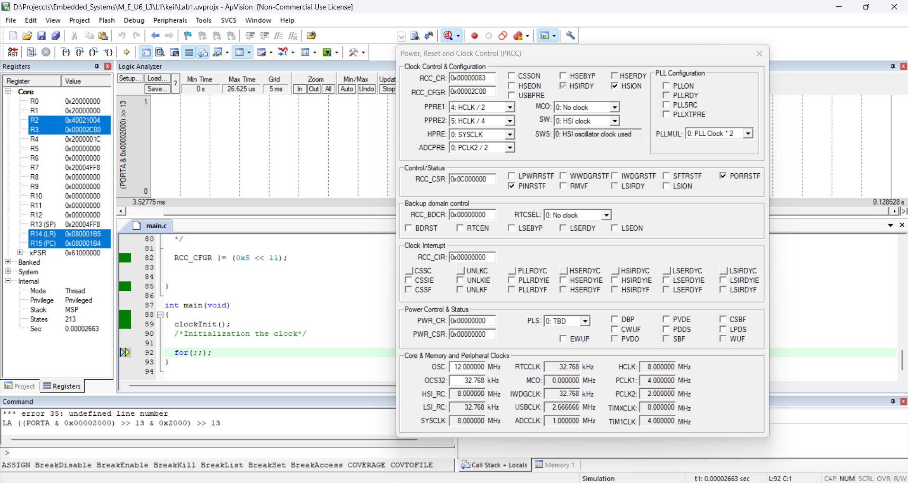
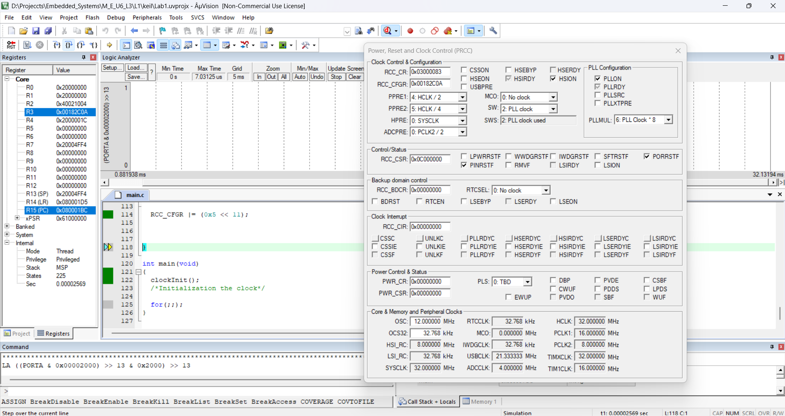

## Author

**Eng. Adel Shata**

---

## Task. 1

### • Configure Board to run with the 

&nbsp;&nbsp;&nbsp;&nbsp;**Following rates:**

&nbsp;&nbsp;&nbsp;&nbsp;&nbsp;&nbsp;&nbsp;&nbsp;`→ APB1 Bus frequency 4MHZ`

&nbsp;&nbsp;&nbsp;&nbsp;&nbsp;&nbsp;&nbsp;&nbsp;`→ APB2 Bus frequency 2MHZ`

&nbsp;&nbsp;&nbsp;&nbsp;&nbsp;&nbsp;&nbsp;&nbsp;`→ AHB frequency 8 MHZ`

&nbsp;&nbsp;&nbsp;&nbsp;&nbsp;&nbsp;&nbsp;&nbsp;`→ SysClk 8 MHZ`

&nbsp;&nbsp;&nbsp;&nbsp;&nbsp;&nbsp;&nbsp;&nbsp;`→ Use only internal HSI_RC`

---

## Task. 2

### • Configure Board to run with the 

&nbsp;&nbsp;&nbsp;&nbsp;**Following rates:**

&nbsp;&nbsp;&nbsp;&nbsp;&nbsp;&nbsp;&nbsp;&nbsp;`→ APB1 Bus frequency 16MHZ`

&nbsp;&nbsp;&nbsp;&nbsp;&nbsp;&nbsp;&nbsp;&nbsp;`→ APB2 Bus frequency 8MHZ`

&nbsp;&nbsp;&nbsp;&nbsp;&nbsp;&nbsp;&nbsp;&nbsp;`→ AHB frequency 32 MHZ`

&nbsp;&nbsp;&nbsp;&nbsp;&nbsp;&nbsp;&nbsp;&nbsp;`→ SysClk 32 MHZ `

&nbsp;&nbsp;&nbsp;&nbsp;&nbsp;&nbsp;&nbsp;&nbsp;`→ Use only internal HSI_RC`

